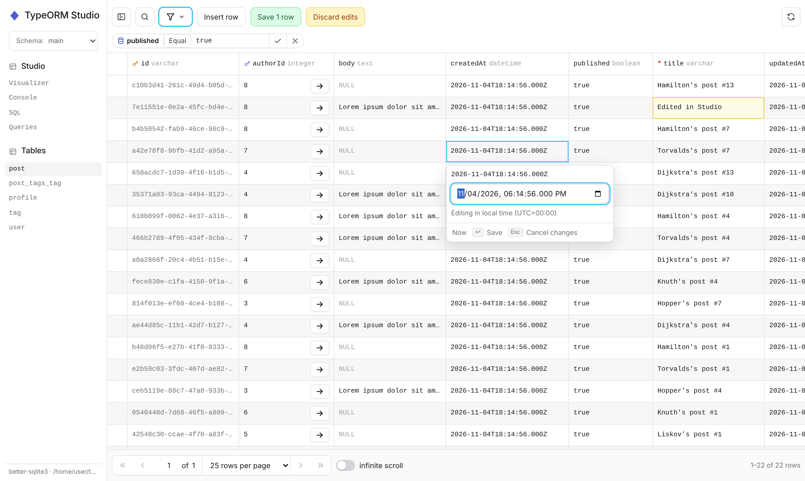
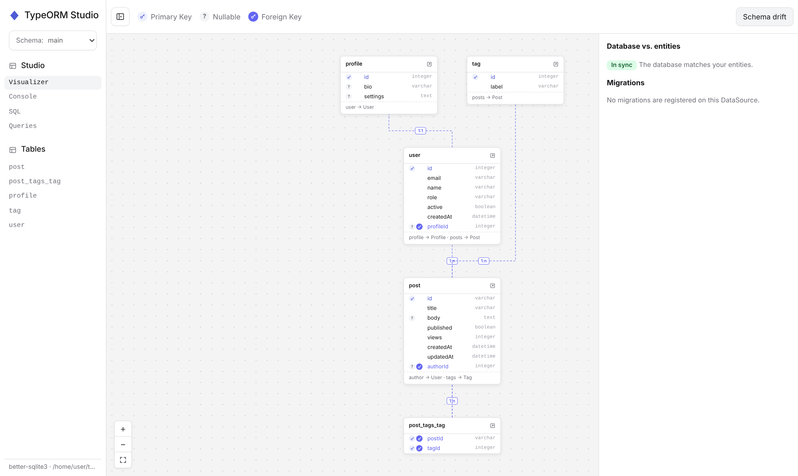
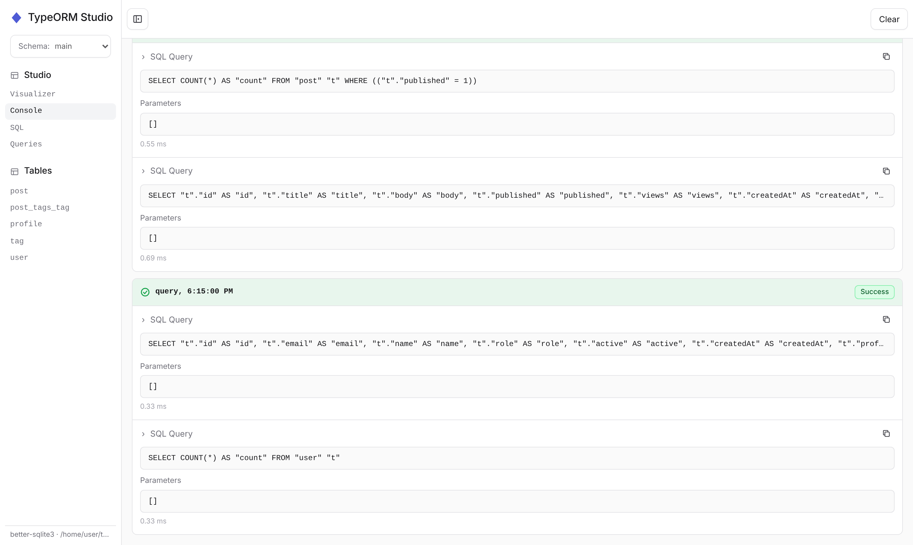
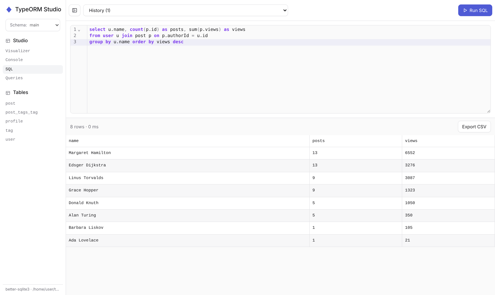
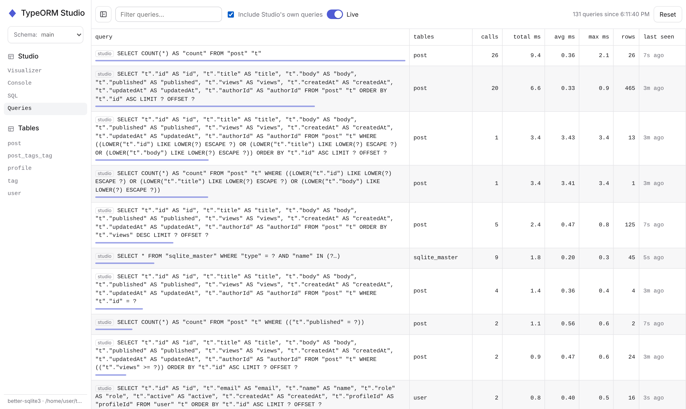

# TypeORM Studio

A visual editor for **TypeORM** projects that works like Prisma Studio. Point it
at your `DataSource`, and you can browse, filter, edit and link through your
data in the browser. It also has a schema visualizer, an operations console, a
SQL editor and live query insights.



The UI follows Prisma Studio's layout and interactions, but the code, name and
logo are this project's own.

## Requirements

- Node.js 20 or later
- TypeORM 0.3.x (a peer dependency: Studio uses your project's copy)
- For a `.ts` data source: `ts-node` or `tsx` installed in your project

## Supported databases

| Database | Status |
|---|---|
| SQLite (`better-sqlite3`) | Tested end to end |
| PostgreSQL | Tested end to end (16) |
| MariaDB | Tested end to end (10.11, through the MySQL driver) |
| MySQL | Covered by the test suite |
| SQL Server | Covered by the test suite |
| MongoDB | Covered by its own test suite, with some differences (below) |

Other databases TypeORM supports may work, but are untested.

**MongoDB** gets a mongosh-style console instead of the SQL editor (for
example `db.users.find({ age: { $gt: 30 } }).sort({ name: 1 })`), and raw
filters take a MongoDB query document instead of a SQL `WHERE` clause. The
Queries view and schema drift are not available for MongoDB. Mark ObjectId
reference fields with `@Column({ type: "objectId" })` so Studio edits and
filters them as ObjectIds.

## Features

### Tables (the Prisma Studio grid)
- **Sidebar**: a schema picker, the Studio views (Visualizer, Console, SQL,
  Queries) and a searchable table list. You can collapse and resize it.
- **Toolbar**: sidebar toggle, row search that expands in place, filter menu,
  **Insert row** and refresh. Context buttons appear when needed:
  - **Save N rows** and **Discard edits** while you have pending edits;
  - **copy as** (CSV, JSON, Markdown, TSV) and **Delete N rows** while rows are
    selected.
- **Column headers** show `name type`. The type is the database's own name
  (`int4`, `varchar`, `timestamp`, `user_role_enum`…). Headers also show a key
  icon for primary and foreign keys and a red `*` for required columns. On
  hover you get **pin** (column sticks to the left) and **sort** (Shift adds a
  second sort). Primary keys come first, then columns in alphabetical order.
- **Filters**: pick a column from a searchable menu, then an operator from
  grouped lists (comparison, text, list, null checks). Each filter becomes a
  **pill** with column, operator, value, ✓ and ✕. Click the join between two
  pills to switch it between AND and OR.
  - **SQL WHERE clause** pills take a raw expression.
- **Search** across text columns, with matches highlighted. A slow search is
  cancelled after 5 s.
- **Cell editors** open in a popover under the cell:
  - text and number: Enter saves, Shift+Enter adds a new line;
  - JSON: validated before saving;
  - true/false and enum: a pick list;
  - dates: a picker that edits in local time, with **Now**.
  - Every editor has **Esc** to cancel and **Set NULL** for nullable columns.
- **Edits are staged** (yellow) and saved together in one transaction.
- **Insert row** adds a draft row at the top. Each cell shows what will be
  stored if you leave it alone: `(default value)`, `NULL` or `(empty string)`.
- **Spreadsheet keys**: arrow keys, Tab, Home/End and PageUp/PageDown move
  between cells. Typing or Enter starts an edit, Space flips true/false,
  Delete sets NULL, and Shift+arrows select a range. **Ctrl/⌘+C** and
  **Ctrl/⌘+V** copy and paste ranges as TSV, to and from spreadsheets.
- **Rows**: click the left gutter to select a row; Shift+click selects a range.
- **Relations**: the **→** button in a foreign-key cell opens the referenced
  row. Columns for the "many" side of a relation (for example `posts` on
  `user`) have a **→** that opens the related rows, with the filter shown as a
  pill.
- **Pagination** (first, previous, page number, rows per page, next, last) or
  an **infinite scroll** toggle.
- **Typed values**: booleans, JSON, ISO dates and column transformers appear as
  your entities see them.
- **Writes go through TypeORM repositories**, so subscribers, generated values,
  create/update date columns, cascades and transformers apply.

### Visualizer

- An entity diagram laid out top-down along foreign keys, with a Primary Key /
  Nullable / Foreign Key legend and `1:n` / `1:1` labels.
- Pan by dragging, zoom with the wheel or the +, − and fit buttons, and drag
  cards to rearrange them. Double-click a card, or use its ↗ button, to open
  the table.
- **Schema drift**: the SQL that `synchronize` would run to make the database
  match your entities (computed, never executed), plus which migrations have
  run.

### Console

A log of every operation Studio performs: query, insert, update, delete, raw
SQL. Each entry shows the exact SQL, its parameters and how long it took.

### SQL

- A CodeMirror editor with highlighting for your database's dialect and
  autocomplete of your tables and columns.
- **Live error checking**: each statement is EXPLAINed, which never executes it.
- **Run SQL** (Ctrl/⌘+Enter) runs everything, or just the selection.
- A history and CSV export.

### Queries

Every statement that goes through the DataSource, grouped by shape. You see
calls, total, average and maximum time, rows returned and errors. Your app's
own traffic appears when Studio is embedded in your app (see below). Click a
statement to open it in the SQL view.

## Usage

### CLI

```bash
npm i -D typeorm-studio
```

```bash
npx typeorm-studio -d src/data-source.ts
```

This opens on http://127.0.0.1:5555.

| Flag | |
|---|---|
| `-d, --dataSource <path>` | File that exports a `DataSource` (default or named export), as with the TypeORM CLI |
| `-p, --port <n>` | Port (default `5555`) |
| `--host <host>` | Bind address (default `127.0.0.1`). Studio warns when this is not a loopback address. |
| `--read-only` | Disable edits, SQL filters and the SQL view |

`.ts` data sources load with `ts-node` when it is installed (it emits the
decorator metadata TypeORM uses to infer column types), otherwise with `tsx`.
With tsx, give columns explicit types and use `Relation<T>` for circular
relations.

### Embedded in your own server (also shows your app's queries)

```ts
import express from "express";
import { createStudioHandler } from "typeorm-studio";
import { AppDataSource } from "./data-source";

const app = express();
// Trailing slash: the UI loads its assets relative to this path.
app.use("/admin/studio/", createStudioHandler(AppDataSource));
```

Options: `readOnly`, `insights` (default `true`), `allowedHosts`.

### Programmatic

```ts
import { createStudioDispatcher } from "typeorm-studio";
import { AppDataSource } from "./data-source";

const studio = createStudioDispatcher(AppDataSource);
const { result, queries } = await studio({ procedure: "query", table: "Post", pageIndex: 0, pageSize: 20 });
```

## Security

Studio can read and change everything the DataSource can reach. It protects you
in these ways:

- **Localhost only by default**: the CLI binds to `127.0.0.1` and rejects
  requests whose `Host` header is not a loopback name, which blocks DNS
  rebinding.
- **No cross-site requests**: the API only accepts same-origin
  `application/json` requests. A page on another site cannot forge a request
  to your Studio.
- **Injection-safe queries**: values are always bound as parameters, and
  table and column names are checked against your entity metadata.
- **SQL filters** must be a single expression, with no `;` and no comments.
- **Error checking never runs your SQL**: statements are only EXPLAINed (in a
  transaction that is rolled back on Postgres and MySQL), and anything that
  could hide a second statement is skipped.
- **`--read-only`** turns off writes, SQL filters and the SQL view.

When you embed Studio in your own server, put your app's authentication in
front of the route.

To report a vulnerability, see [SECURITY.md](SECURITY.md).

## Protocol

All requests are `POST /api` with `Content-Type: application/json` and body
`{ procedure, … }`. Every reply is `{ ok, result | error, queries }`, where
`queries` is the SQL the operation ran.

| procedure | payload | result |
|---|---|---|
| `introspect` | none | `{ driver, database, tables[], filterOperators[], capabilities }` |
| `query` | `table, pageIndex, pageSize, sortOrder?, filter?, search?` | `{ rows, filteredRowCount, sql, durationMs }` |
| `insert` | `table, rows[]` | `{ rows }` |
| `update` | `table, updates[{ row (pk), changes }]` | `{ rows }` |
| `delete` | `table, rows[] (pk)` | `{ affected }` |
| `raw` | `sql` | `{ rows, rowCount, durationMs }` |
| `count` | `tables?` | `{ [entity]: number }` |
| `sql-schema` | none | `{ dialect, namespace }` |
| `sql-lint` | `sql` | `{ diagnostics[] }` |
| `insights` | `since?, limit?, includeStudio?, reset?` | `{ totalQueries, queries[] }` |
| `schema-diff` | none | `{ inSync, up[], down[] }` |
| `migrations` | none | `{ configured, migrations[] }` |

Filters are a tree of `ColumnFilter`, `SqlFilter` and `FilterGroup` nodes.

## Limitations

- **MariaDB 10.10+ shows false drift**: right after a sync, TypeORM still
  reports `CHANGE … NULL` and foreign-key statements for nullable columns
  (`typeorm schema:log` reports the same). The Visualizer says so.
- **Search timeouts on other databases**: outside Postgres and MySQL/MariaDB,
  a slow search is abandoned after 5 s, but the database may finish running
  the query in the background.
- **Not ported**: Prisma Studio's *Streams* view, which depends on Prisma
  Postgres.

## Contributing

See [CONTRIBUTING.md](CONTRIBUTING.md) for building from source, the example
database and running the tests.

## License

[MIT](LICENSE)
